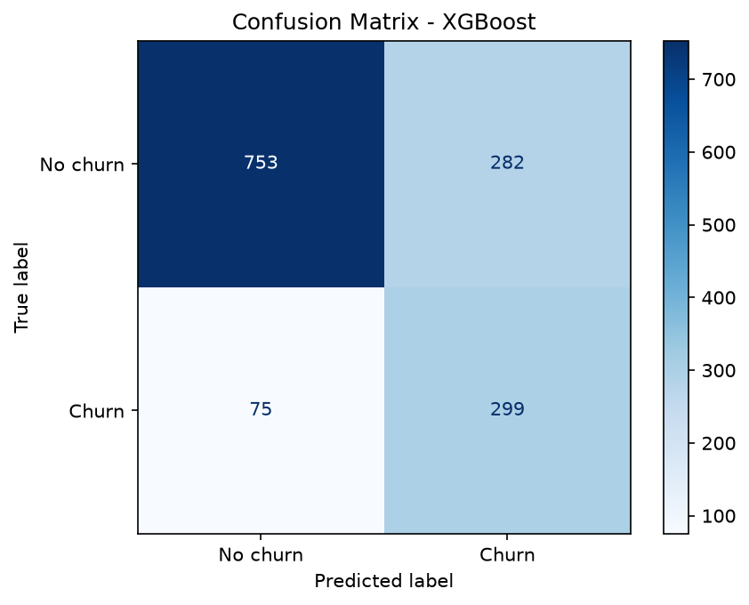

# Model Evaluation Report: Customer Churn Prediction

## 1. Objective

Predict whether a telecom customer will churn, using the IBM Telco Customer
Churn dataset (7,043 customers, about 26% churners). Missing a churner (false
negative) costs more than a wasted retention offer (false positive), so the
main metrics are **recall** (share of churners caught) and **ROC-AUC**
(ranking quality independent of threshold). Precision, F1, and accuracy are
reported for completeness.

## 2. Data and Evaluation Setup

- **Split:** stratified 80/20 train/test split (`random_state=42`), giving 1,409
  test customers, 374 of whom churned.
- **Preprocessing:** implemented in `src/preprocessing.py` (cleaning, encoding,
  scaling) and bundled with each model in a single scikit-learn Pipeline.
- **Class imbalance:** handled with cost-sensitive learning instead of
  resampling: `class_weight="balanced"` for Logistic Regression and Random
  Forest, and `scale_pos_weight` for XGBoost. All metrics use the default
  0.5 decision threshold.
- **Tuning:** `RandomizedSearchCV` with 5-fold `StratifiedKFold` (shuffled,
  `random_state=42`), scored on ROC-AUC. The test set was used only for the
  final evaluation.

## 3. Models Compared

| Model | Best hyperparameters |
|---|---|
| Logistic Regression | C = 0.1 |
| Random Forest | 200 trees, max_depth = 8, min_samples_leaf = 10, max_features = sqrt |
| XGBoost | 100 trees, max_depth = 2, learning_rate = 0.1, subsample = 0.7, colsample_bytree = 0.85 |

## 4. Results

### Test-set performance

| Model | Accuracy | Precision | Recall | F1 | ROC-AUC |
|---|---|---|---|---|---|
| Logistic Regression | 0.737 | 0.503 | 0.786 | 0.614 | 0.842 |
| Random Forest | 0.754 | 0.524 | 0.797 | 0.632 | 0.844 |
| **XGBoost (final)** | 0.747 | 0.515 | **0.799** | 0.626 | **0.847** |

### Cross-validated ROC-AUC (training data) and train-test gap

| Model | CV ROC-AUC | Train ROC-AUC | Test ROC-AUC | Gap (train - test) |
|---|---|---|---|---|
| Logistic Regression | 0.846 | 0.850 | 0.842 | 0.008 |
| Random Forest | 0.848 | 0.887 | 0.844 | 0.043 |
| XGBoost | 0.850 | 0.863 | 0.847 | 0.016 |

### Confusion matrices (test set, 1,409 customers)

Derived from the reported precision, recall, and accuracy.

| Model | True Positives | False Negatives | False Positives | True Negatives |
|---|---|---|---|---|
| Logistic Regression | 294 | 80 | 290 | 745 |
| Random Forest | 298 | 76 | 271 | 764 |
| XGBoost | 299 | 75 | 282 | 753 |

The XGBoost matrix is saved as `reports/confusion_matrix.png`.

## 5. Analysis

- **All three models perform similarly.** Test ROC-AUC ranges only from 0.842 to
  0.847, so the differences are small and probably within sampling noise on a
  test set of this size. The data seems to limit performance more than the
  choice of algorithm.
- **XGBoost** has the highest CV ROC-AUC (0.850), the highest test ROC-AUC
  (0.847), and the highest recall (0.799). It catches 299 of the 374 churners
  and misses 75.
- **Random Forest** overfits the most (train AUC 0.887 against test 0.844).
  XGBoost uses shallow trees (depth 2) and shows a much smaller gap, so it
  should generalise better.
- **Logistic Regression** is a strong baseline and the easiest to interpret,
  within 0.005 AUC of the best model.
- **Precision is about 0.51.** Roughly half of the customers flagged as likely
  to churn actually churn. This follows from the class weighting, which
  favours recall: the model accepts more false alarms (282 in the test set) to
  miss fewer churners. It is reasonable when a retention offer is cheap
  relative to losing a customer. The decision threshold can be moved to change
  this trade-off.

## 6. Final Model Choice

**XGBoost** is the final model (test ROC-AUC 0.847, recall 0.799). It has the
best cross-validated and test scores and a small train-test gap, and it is
saved as `models/churn_model.joblib` and served by the FastAPI app in
`api/main.py`.

## 7. Limitations and Next Steps

- Differences between models are small. Repeated cross-validation or a
  significance test would show whether XGBoost is reliably better.
- Tune the decision threshold against actual retention cost and offer cost.
- Check probability calibration before using the probabilities as risk scores.
- Add monitoring for data drift and retrain on newer data.
- The dataset is a single snapshot and has no time dimension, so real-world
  performance could be lower.